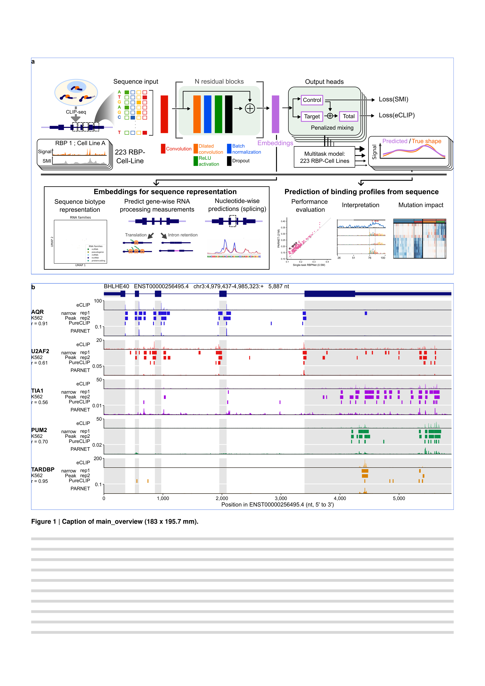

# main_overview

Figure 1 of the manuscript: the PARNET pipeline and its applications, and one test transcript with observed and predicted binding profiles.
Issue: [#11](https://github.com/marsico-lab/parnet--paper/issues/11).

| Panel      | Content                                                                                    | Made with                                                                              |
| ---------- | ------------------------------------------------------------------------------------------ | -------------------------------------------------------------------------------------- |
| `abstract` | PARNET pipeline and applications (hand-made schematic)                                     | `notebooks/graphical_abstract.py`, `assets/parnet-pipeline-applications.pdf`           |
| `profile`  | BHLHE40: eCLIP read starts, narrowPeaks, PureCLIP sites and PARNET profile for 5 K562 RBPs | `notebooks/profile_example_BHLHE40.py`, `scripts/profile_panel.py`, `data/*_BHLHE40.*` |

Layouts: `layout.bhlhe40.yaml` (selected, the paper version), `layout.gata2.yaml` and `layout.myc.yaml` (alternative profile panels).
The three candidates, why their tracks were chosen and what each shows: [docs/profile_examples.md](docs/profile_examples.md).
Text is 7 / 6 pt, and the layouts reject anything below 6 pt.

The origin of every table is in [data/README.md](data/README.md), of the schematic in [assets/README.md](assets/README.md).
Build it with `pixi run figure main_overview`.

