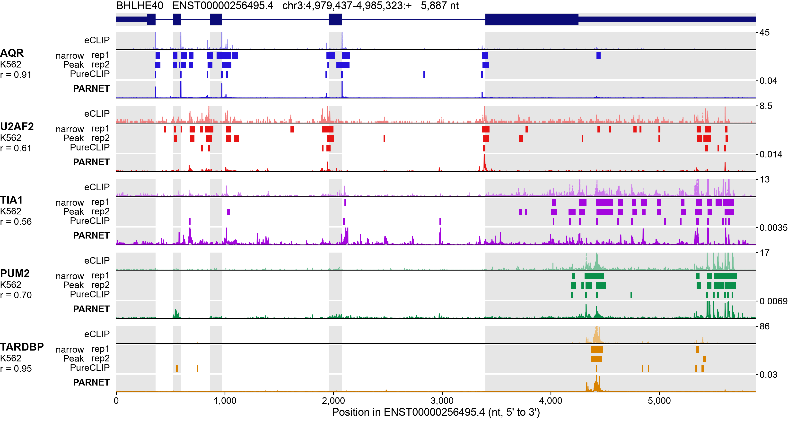
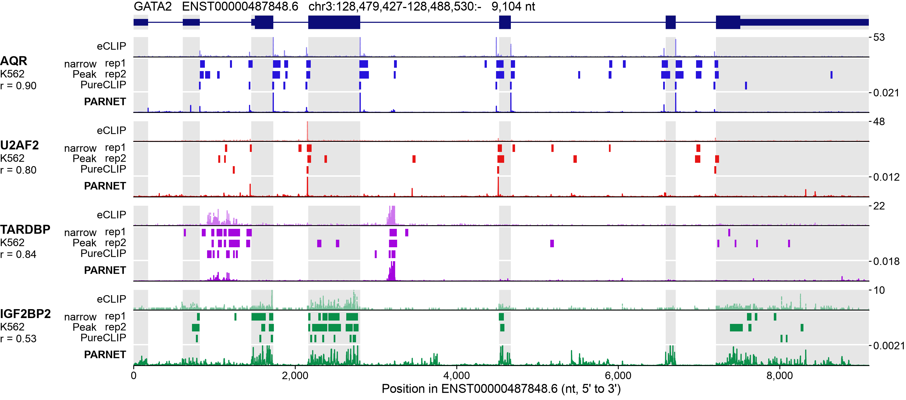
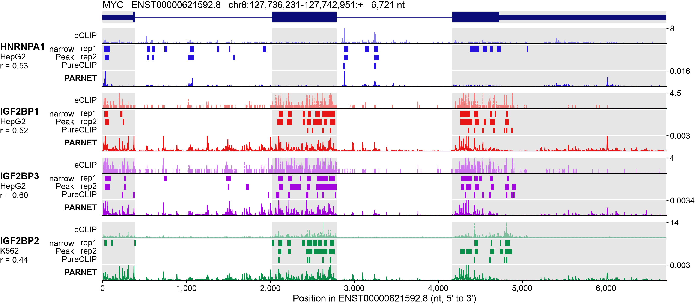

# Transcript profile examples for the overview figure

## What this is

Three candidate panels, each showing one transcript with a handful of RBPs. Every panel
has the same rows: observed eCLIP read starts for both replicates, the peaks called on
them, and the PARNET profile predicted from sequence alone. They are meant to replace the
example panel in the current Figure 1, which was criticised for being sparse and for
showing a predicted QKI peak with nothing under it.

BHLHE40 is the panel of the figure (`layout.bhlhe40.yaml`, selected by `layout.yaml`).
GATA2 and MYC stay in the repository as alternatives, each with its own layout; their
renderings are below, at their size in the figure.

| Notebook                               | Transcript              | Tracks                                                    | What it argues                                                                                               |
| -------------------------------------- | ----------------------- | --------------------------------------------------------- | ------------------------------------------------------------------------------------------------------------ |
| `notebooks/profile_example_BHLHE40.py` | BHLHE40, chr3, 5,887 nt | AQR, U2AF2, TIA1, PUM2, TARDBP (K562)                     | Each predicted peak lands on a feature you can name: a splice site, a pyrimidine tract, a UG repeat, a 3'UTR |
| `notebooks/profile_example_GATA2.py`   | GATA2, chr3, 9,104 nt   | AQR, U2AF2, TARDBP, IGF2BP2 (K562)                        | Two positional markers plus two sequence-specific binders, on a transcript that matters in K562              |
| `notebooks/profile_example_MYC.py`     | MYC, chr8, 6,721 nt     | HNRNPA1 (HepG2), IGF2BP1, IGF2BP3 (HepG2), IGF2BP2 (K562) | A named binding element from the literature, and agreement across three experiments in two cell lines        |

BHLHE40 and GATA2 are the stronger two. BHLHE40 answers the criticism of the old panel
most directly, since there is an independent reason for every peak it shows. GATA2 adds
something BHLHE40 cannot show on its own: TARDBP is a 3'UTR binder on BHLHE40 and an
intronic binder on GATA2, and the model follows the sequence in both cases instead of
applying a fixed positional preference. The two panels together make that point.

MYC is the weakest of the three and the notebook says so. The three IGF2BP paralogs
behave almost identically, so the panel is a reproducibility check rather than three
separate observations, and the prediction does not single out the coding region
determinant even though the observed data do.

## How the candidates were chosen

The starting table is the per-transcript evaluation on the held-out test chromosomes,
`results/full_transcripts_evaluation/2026-10-08_mane_v1_4_testchroms_max100kb_v3/metrics.per_transcript_rbp.parquet`
in `parnet--analyses--performance-evaluation`. It covers 1,182 transcripts and 223 eCLIP
tracks.

Pairs were kept when the transcript had at least 50 read starts and at least 10
narrowPeak-positive positions for that RBP, which leaves 130,497 of them. Each pair was
then ranked twice on the Pearson correlation of the predicted total profile with the
observed read starts: once against all pairs, and once against the other transcripts of
the same RBP. The second ranking is the one that stops the selection from simply
collecting tracks that are easy everywhere.

Every track in the three panels is in the top 5% of all pairs and the top 11% within its
own RBP. The numbers are in `data/panel_<GENE>.json` and in the table each notebook
prints, so they can be quoted in a caption.

There is one exception worth repeating here. PUM2 on BHLHE40 is in the top 0.4% of all
pairs, but PUM2 as a track sits at the 44th percentile of RBPs across the whole test set.
It is in the panel because it illustrates 3'UTR binding cleanly. KHDRBS1_K562 or
IGF2BP2_K562 are the substitutes if a uniformly strong set matters more.

## Checking the peaks against sequence

The claims in the notebooks about splice sites, pyrimidine tracts and UG repeats were not
read off the figures. For each track the strongest predicted peaks were located, then the
surrounding sequence and the distance to the nearest annotated donor and acceptor were
measured. That is where the statements about GGTGAGT donors, the 9 to 10 nt offset from
acceptors, and the twelve-unit UG repeat come from.

The script that does it is not in this repository, since it needs the genome and the
annotation. It lives on ms-01-2 at
`/localscratch/l10n/.claude-science-scratch/figsel/verify.py` and is also saved as an
artifact in the conversation that produced these panels.

## Rebuilding the data

```bash
pixi run python scripts/make_profile_data.py
```

It reads the eCLIP bigwigs, the peak files and the hg38 sequence from NAS2, runs the
released 21M penalty-5.0 model on the unspliced transcript, and writes the three files per
candidate into `data/`. One transcript takes about ten seconds on CPU, so no GPU is
needed.

Two details of that script are deliberate. The sequence is uppercased before one-hot
encoding, because the repeat-masked FASTA would otherwise be silently hard-masked and the
predictions over repeats would be wrong, which matters here since TARDBP binds UG repeats.
And everything is flipped into transcript orientation, so position 0 is the TSS on both
strands and the panels read 5' to 3' from left to right.

## Drawing

`scripts/profile_panel.py` holds the drawing code, shared by the three notebooks.
`draw(gene, panel)` lays the panel out in millimetres inside the plotplate box: the text
stays at 7 pt (RBP name, title, x label) and 6 pt (everything else) whatever the number of
RBPs, and only the row heights follow the box height.

Rows of each RBP, top to bottom: eCLIP read starts (replicate 1 solid, replicate 2 dashed),
the narrowPeaks of replicates 1 and 2, the PureCLIP crosslink sites, and the PARNET profile.
Each eCLIP and PARNET row is cut at half its maximum (`CLIP = 0.5` in the notebooks), so that the lower
signal is visible next to the tallest peaks; its one y tick, on the right, is the top of the row. Grey bands mark the exons.
`draw(..., prediction="pred_target")` switches the PARNET row from the total profile, which
is what the observed read starts correspond to, to the de-biased target profile.

To build a candidate: `pixi run use-layout main_overview gata2`, then
`pixi run figure main_overview`; switch back with `pixi run use-layout main_overview bhlhe40`
before promoting.

## The three candidates

The images below are `docs/candidates/profile_<gene>.png`, copies of the built panel; rebuild
them after a change to the drawing code.

### BHLHE40 (in the figure)



### GATA2



### MYC


