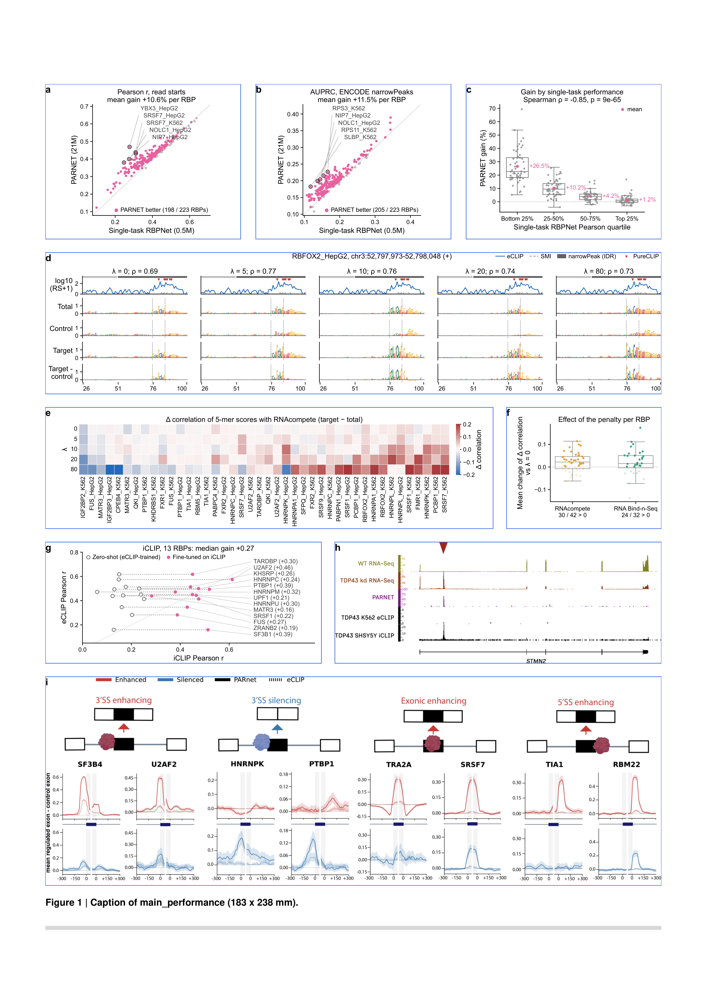

# main_performance

Figure 2 of the manuscript: PARNET performance against single-task RBPNet, the effect of the penalty on the mixing coefficient, and iCLIP.
Issue: [#4](https://github.com/marsico-lab/parnet--paper/issues/4).
The draft this figure replaces is `reference/figure2_draft_2026-10.png`.

| Panel              | Content                                                              | Made with                                                                              |
| ------------------ | -------------------------------------------------------------------- | -------------------------------------------------------------------------------------- |
| `perf_correlation` | Per-RBP Pearson r (switch: Spearman), single-task RBPNet vs PARNET   | `notebooks/perf_correlation.py`, `data/perf/per_rbp_metrics.600nt_test_split.tsv`      |
| `perf_auprc`       | Per-RBP AUPRC against ENCODE narrowPeak 5' ends (switch: PureCLIP)   | `notebooks/perf_auprc.py`, `data/perf/per_rbp_metrics.600nt_test_split.tsv`            |
| `perf_quartiles`   | PARNET gain per quartile of single-task Pearson                      | `notebooks/perf_quartiles.py`, `data/perf/per_rbp_metrics.600nt_test_split.tsv`        |
| `region_featimp`   | RBFOX2_HepG2 region: attributions per track and penalty              | `notebooks/region_featimp.py`, `data/region_featimp/`                                  |
| `kmer_heatmap`     | Target-vs-total 5-mer contrast with RNAcompete per penalty           | `notebooks/kmer_heatmap.py`, `data/kmer_contrast/`                                     |
| `kmer_benefit`     | Mean change of that contrast vs λ = 0, RNAcompete and RNA Bind-n-Seq | `notebooks/kmer_benefit.py`, `data/kmer_contrast/`                                     |
| `iclip`            | iCLIP zero-shot vs fine-tuned, two points per RBP                    | `notebooks/iclip.py`, `data/iclip/`                                                    |
| `tdp43_example`    | TDP-43 / STMN2 example (collaborator image)                          | `notebooks/tdp43_example.py`, `assets/parnet_fig_perf_panel_stmn2.png`                 |
| `rna_maps`         | RNA maps of splicing regulation (collaborator image)                 | `notebooks/rna_maps.py`, `assets/parnet_fig_perf_panel_splicing.svg` (rendered to PNG) |

Models of panel `region_featimp` (experiment `parnet_21m_scratch_penalty_sweep`): λ = 0 `parnet.21m-0.0`, λ = 5 `parnet.21m-5.0`, λ = 10, 20, 80 `parnet.21m-scratch-{10,20,80}.0` (PARNET 21M, every model trained from random initialisation).
Models of panels `kmer_heatmap` and `kmer_benefit` (experiment `parnet_7m`): `parnet.7m-{0.0,2.5,10.0,20.0,80.0}` (PARNET 7M, trained from scratch, 2025-01-10); the 21M set is one switch away (`EXPERIMENT`).
The heatmap labels the `parnet.7m-2.5` model as λ = 5, the display label of the analysis notebook and of the preprint (its config and file name say 2.5).

The origin of every table is in [data/README.md](data/README.md).
Build it with `pixi run figure main_performance`.

