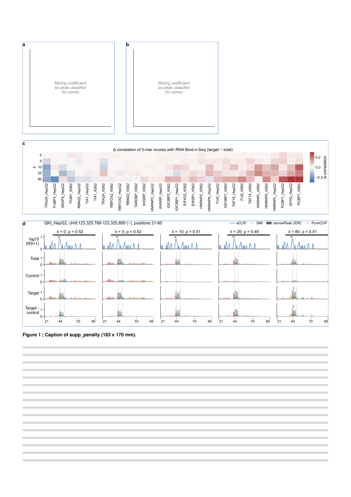

# supp_penalty

Extended Data Figure 2, related to Figure 2 ([main_performance](../main_performance/)): the mixing coefficient and the penalty λ.
Issue: [#15](https://github.com/marsico-lab/parnet--paper/issues/15).

| Panel                | Content                                                                                         | Made with                                                                      |
| -------------------- | ----------------------------------------------------------------------------------------------- | ------------------------------------------------------------------------------ |
| `mix_classifier_a`   | Mixing coefficients as a peak-vs-background classifier (placeholder)                            | `notebooks/mix_classifier_a.py`                                                |
| `mix_classifier_b`   | Mixing coefficients as a peak-vs-background classifier (placeholder)                            | `notebooks/mix_classifier_b.py`                                                |
| `kmer_heatmap_rbns`  | Target-vs-total 5-mer contrast with RNA Bind-n-Seq per λ (as Figure 2 kmer_heatmap, RNAcompete) | `notebooks/kmer_heatmap_rbns.py`, `data/kmer_contrast/`                        |
| `region_featimp_qki` | QKI_HepG2 region: attributions per track and λ (as Figure 2 region_featimp, RBFOX2_HepG2)       | `notebooks/region_featimp_qki.py`, `data/region_featimp/`, `scripts/common.py` |

Text is 7 / 6 pt, and the layout rejects anything below 6 pt.
The origin of every table is in [data/README.md](data/README.md).
Build it with `pixi run figure supp_penalty`.

