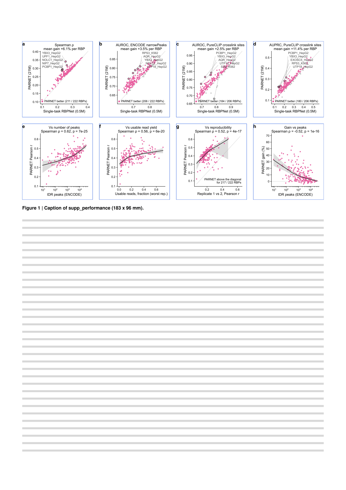

# supp_performance

Supplementary figure related to Figure 2 ([main_performance](../main_performance/)): PARNET 21M against the single-task RBPNet models on the metrics not shown in Figure 2, and PARNET performance against the quality of the eCLIP data.

Windows, models and RBP names are those of main_performance panels a to c: test split of the 600 nt training dataset, windows with >= 10 read starts and >= 5 covered positions with consecutive gaps \<= 3 nt, RBPs with >= 20 such windows.

| Panel                | Content                                                                                                  | Made with                         |
| -------------------- | -------------------------------------------------------------------------------------------------------- | --------------------------------- |
| `perf_spearman`      | Per-RBP Spearman correlation with read starts, single-task RBPNet vs PARNET                              | `notebooks/perf_spearman.py`      |
| `perf_np_auroc`      | AUROC against ENCODE narrowPeak 5' ends +- 5 nt                                                          | `notebooks/perf_np_auroc.py`      |
| `perf_pc_auroc`      | AUROC against PureCLIP crosslink sites +- 5 nt                                                           | `notebooks/perf_pc_auroc.py`      |
| `perf_pc_auprc`      | AUPRC against PureCLIP crosslink sites +- 5 nt                                                           | `notebooks/perf_pc_auprc.py`      |
| `quality_peaks`      | PARNET Pearson r vs the number of IDR peaks of the experiment                                            | `notebooks/quality_peaks.py`      |
| `quality_nonpcr`     | PARNET Pearson r vs the usable read yield: unique, non-PCR-duplicate reads / all reads (worst replicate) | `notebooks/quality_nonpcr.py`     |
| `quality_replicates` | PARNET Pearson r vs the Pearson r between the two replicates, on the same windows                        | `notebooks/quality_replicates.py` |
| `quality_gain`       | Relative gain of PARNET over single-task RBPNet (Pearson) vs the number of IDR peaks                     | `notebooks/quality_gain.py`       |

All panels read `data/per_rbp_quality.600nt_test_split.tsv`; the drawing code is in `scripts/common.py`.
Panels e to h show a LOWESS trend (2/3 of the RBPs per local fit; on log10 x for e and h), its 95% confidence band (500 bootstrap resamples of the RBPs, seed 42) and the Spearman rho.
The scatters use the same code as main_performance: pink, PARNET better; grey, single-task better; the 5 RBPs with the largest difference are ringed and named.

The origin of the table is in [data/README.md](data/README.md).
Build it with `pixi run figure supp_performance`.

