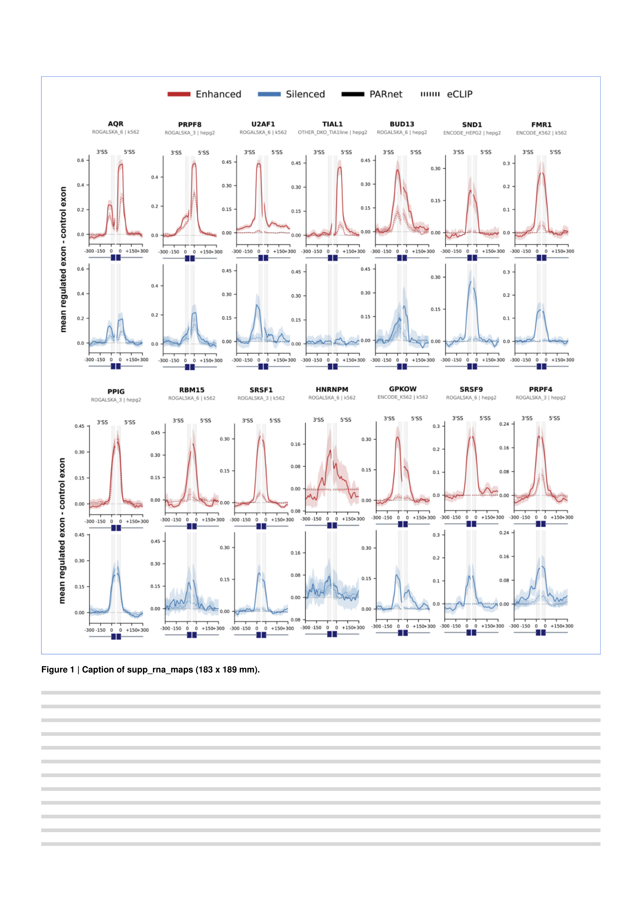

# supp_rna_maps

Extended Data Figure 3, related to Figure 2 (panel `rna_maps` of [main_performance](../main_performance/)): exon-intron meta-profiles of RBP binding estimated from eCLIP signal (dotted lines) and PARNET predictions (solid lines) for exons enhanced or silenced after knockdown of an expanded set of RBPs.
Issue: [#13](https://github.com/marsico-lab/parnet--paper/issues/13).

| Panel      | Content                                   | Made with                                                      |
| ---------- | ----------------------------------------- | -------------------------------------------------------------- |
| `rna_maps` | RNA maps for 14 RBPs (collaborator image) | `notebooks/rna_maps.py`, places `assets/rna_maps_expanded.png` |

The origin of the image is in [assets/README.md](assets/README.md).
Build it with `pixi run figure supp_rna_maps`.

