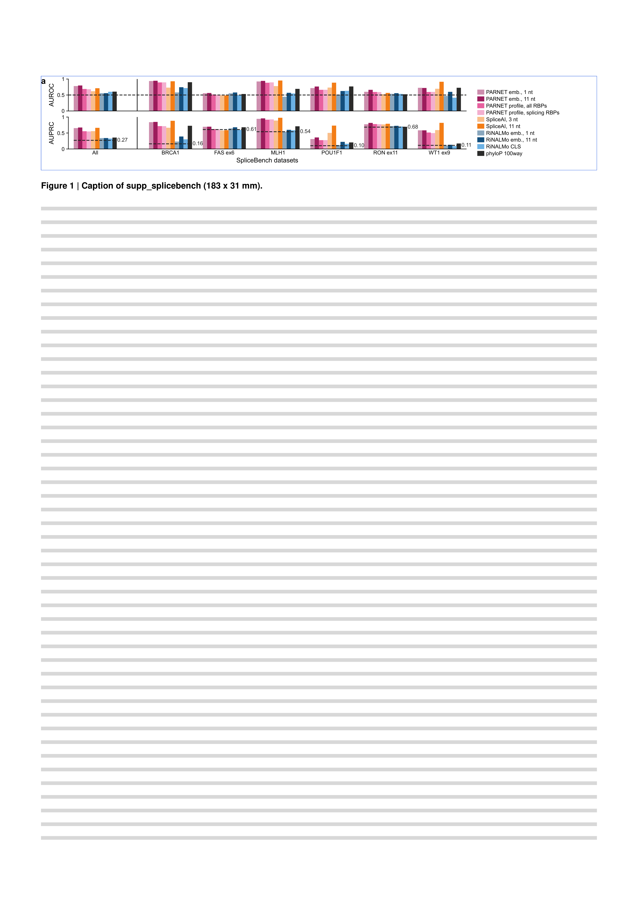

# supp_splicebench

Supplementary figure: SpliceBench, AUROC and AUPRC of the variant-effect methods on each of the 6 SpliceBench datasets, with all datasets pooled as a first group.
The pooled ROC and PRC curves are panel a of [main_mutations](../main_mutations/).

| Panel            | Content                                                                    | Made with                                                                                    |
| ---------------- | -------------------------------------------------------------------------- | -------------------------------------------------------------------------------------------- |
| `sb_performance` | AUROC and AUPRC of 10 methods per SpliceBench dataset, pooled group first | `notebooks/sb_performance.py`, `data/splicebench/`, `data/roc_prc/splicebench.json` |

The colours and the method families are those of the main_mutations ROC/PRC panels; the lighter tint is the narrow window (or, for the PARNET profile, the splicing RBPs only).
Dashed lines: AUROC 0.5, and each dataset's AUPRC baseline (fraction of splicing-disrupting variants).
`SHOW_POOLED = False` in the notebook removes the pooled group.

The origin of every table is in [data/README.md](data/README.md).
Build it with `pixi run figure supp_splicebench`.

